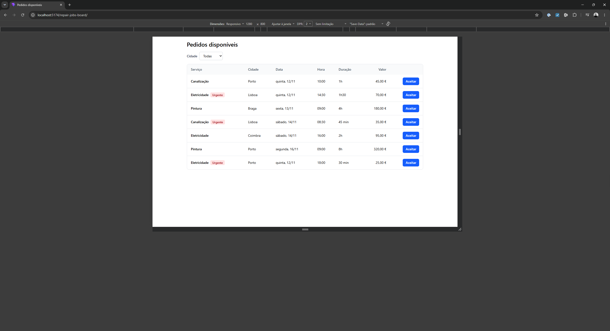
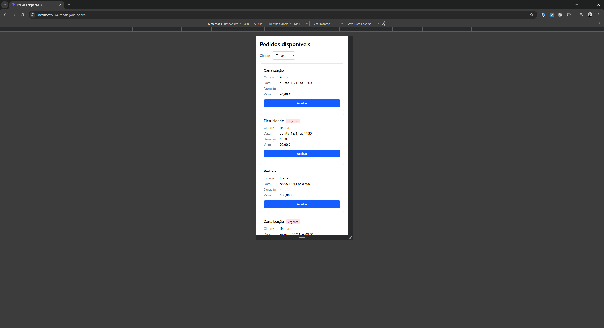

# Pedidos disponíveis

> Exercício técnico de frontend (nov. 2026).

Ecrã onde um profissional vê os pedidos de reparação disponíveis, filtra por cidade e aceita os que lhe interessam.

<p align="center">
  
  
</p>

Feito com React 19, TypeScript, Vite e Tailwind CSS. Testes com Vitest e Testing Library.

## Como correr

Requisitos: Node.js 22.22+ ou 24.15+ e [pnpm](https://pnpm.io/installation).

```bash
pnpm install
pnpm dev
```

Outros comandos:

- `pnpm test run`: corre os testes uma vez (sem `run`, fica a vigiar alterações).
- `pnpm lint`: verifica o código com o oxlint.
- `pnpm build`: verifica os tipos e gera a versão de produção em `dist/`.

## Se tivesse mais tempo

- Ligar a uma API (por exemplo em NestJS), com estados de erro e aceitação otimista com reversão.
- Pedir confirmação ou permitir anular ao aceitar, com feedback visível.
- Ordenar por data e filtrar também por serviço e por urgência.
- Testes end-to-end com Playwright para as duas vistas responsivas, que o jsdom não cobre.